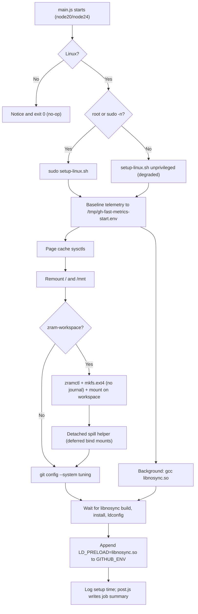

# make-github-action-fast

A lightweight, zero-dependency GitHub Action that accelerates Linux CI workflows by eliminating disk I/O bottlenecks, bypassing redundant fsync operations, tuning Linux kernel page-cache writeback, optimizing Git operations, and optionally hosting the workspace in an in-memory compressed zram disk with deferred SSD spillover.

Ephemeral CI runners in GitHub Actions are frequently bottlenecked by virtualized disk I/O: builds and package managers issue thousands of redundant `fsync` calls, the Linux kernel aggressively flushes dirty pages to virtual disks, and filesystem metadata updates create high I/O latency. Because CI runners are destroyed immediately after job completion, disk durability guarantees (`fsync`, write barriers, access-time updates) offer no benefit and significantly prolong build times. `make-github-action-fast` removes these bottlenecks with a setup step that targets < 300 ms. It has zero npm dependencies, requires zero configuration for common workflows, and adheres strictly to a golden safety rule: **it never fails your CI job**—if any privileged operation is restricted (such as in unprivileged container jobs), it logs a warning and degrades gracefully.

---

## Quick Start

Place `make-github-action-fast` as the first step in your job, before `actions/checkout@v4`. This ensures filesystem remounts, page-cache sysctl tuning, Git configurations, and `LD_PRELOAD` environment variables are active before repository extraction and dependency installation:

```yaml
jobs:
  build:
    runs-on: ubuntu-latest
    steps:
      - name: Speed up runner
        uses: boazberman/make-github-action-fast@v1

      - name: Checkout code
        uses: actions/checkout@v4

      - name: Install and test
        run: |
          npm ci
          npm test
```

---

## Max-Speed zram Mode

For disk-heavy workloads—such as compiling large Rust or C++ codebases, building monorepos, or running disk-intensive test suites—enable `zram-workspace: true`. This mounts a high-speed, in-memory compressed ext4 volume (`lz4`) over the runner's workspace, eliminating virtual disk latency entirely.

To prevent running out of memory when large build caches or dependencies are pulled, heavy directories are automatically spilled to the physical SSD via deferred bind mounts:

```yaml
jobs:
  test:
    runs-on: ubuntu-latest
    steps:
      - name: Speed up runner (zram workspace)
        uses: boazberman/make-github-action-fast@v1
        with:
          zram-workspace: 'true'
          zram-size: '8G'
          spill-dirs: 'node_modules,target,.cargo'

      - name: Checkout code
        uses: actions/checkout@v4

      - name: Build and test
        run: cargo test
```

---

## Inputs & Outputs

### Inputs

| Input | Description | Default |
|---|---|---|
| `fsync-bypass` | Intercept `fsync`, `fdatasync`, `sync`, `msync`, and strip `O_SYNC`/`O_DSYNC` flags via `LD_PRELOAD` `libnosync.so`. | `'true'` |
| `page-cache-tuning` | Optimize Linux page cache dirty ratios and flush intervals for ephemeral memory buffers. | `'true'` |
| `remount-fast` | Remount ext4 filesystems (`/` and `/mnt`) with `noatime,nodiratime,barrier=0,commit=600`. | `'true'` |
| `git-tuning` | Apply high-performance Git configuration (`feature.manyFiles`, multithreading, caches, disable auto-gc). | `'true'` |
| `zram-workspace` | Mount an in-memory compressed ext4 zram disk over `$GITHUB_WORKSPACE`. | `'false'` |
| `zram-size` | Size of the zram disk device (e.g., `4G`, `6G`, `8G`). | `'6G'` |
| `spill-dirs` | Comma-separated directory names to bind-mount to `/mnt/gh-fast-spill` on SSD when zram is active. | `'node_modules,.cargo,.gradle,.venv,target'` |
| `summary` | Emit an optimization breakdown and detailed I/O telemetry table to `$GITHUB_STEP_SUMMARY`. | `'true'` |

### Outputs

| Output | Description | Example |
|---|---|---|
| `setup-time-ms` | Wall clock time taken by setup execution in milliseconds. | `142` |
| `fsync-bypass` | Status of the fsync bypass interceptor (`active`, `disabled`, or `failed`). | `active` |
| `zram-device` | Allocated zram device path (e.g. `/dev/zram0`), or empty if zram workspace is disabled. | `/dev/zram0` |

---

## How It Works

### 1. Fsync Interceptor via LD_PRELOAD (`libnosync.so`)
Package managers (npm, pip, cargo), databases (SQLite, embedded test DBs), and compilers frequently issue `fsync()`, `fdatasync()`, `msync()`, or open files with `O_SYNC` to guarantee durability on persistent storage. In ephemeral CI runners, flushing writes to disk is unnecessary overhead.

- **Fast on-the-fly compilation**: Rather than running `apt-get install eatmydata` (which takes ~6 seconds to update apt indexes and download packages), `make-github-action-fast` compiles `src/nosync.c` using the runner's preinstalled `gcc` in **~100 ms**.
- **Complete syscall coverage**: It no-ops `fsync`, `fdatasync`, `sync`, `syncfs`, `msync`, and `sync_file_range`. It also wraps `open`, `open64`, `openat`, `openat64`, and glibc fortified variants (`__open_2`, `__openat_2`), stripping `O_SYNC` and `O_DSYNC` flags.
- **Setuid / sudo safety**: On Linux, setuid binaries (like `sudo`) refuse to load arbitrary paths from `LD_PRELOAD` under `AT_SECURE`, emitting noisy warnings (`ERROR: ld.so: object ... cannot be preloaded`). To prevent this:
  1. The library is installed to `/usr/local/lib/libnosync.so` and registered in `/etc/ld.so.conf.d/nosync.conf` with a detached `ldconfig`.
  2. A trusted multiarch setuid copy is installed to `/usr/lib/$(gcc -dumpmachine)/libnosync.so` with mode `4755`.
  3. `LD_PRELOAD` is exported as filename-only `libnosync.so`.
  4. The library inspects `getauxval(AT_SECURE)` in its constructor; under setuid execution, it acts as a transparent passthrough, preserving standard security behavior.

### 2. Page Cache Sysctl Tuning
Linux kernel defaults are tuned for general-purpose servers that must avoid data loss during unexpected power outages. For an ephemeral CI runner with ample RAM (7–16 GB on standard hosted runners, more on larger runners), flushing dirty pages to virtual disk prematurely starves foreground build tasks of I/O throughput.

The action tunes the following parameters via direct writes to `/proc/sys/vm/` and `/proc/sys/fs/`:

| Parameter | Default Value | Tuned Value | Rationale |
|---|---|---|---|
| `vm.dirty_ratio` | `20%` | `80%` | Maximum percentage of system memory that can hold dirty pages before processes are blocked to write dirty data to disk. Written first to prevent ratio clamping. |
| `vm.dirty_background_ratio` | `10%` | `50%` | Percentage of system memory at which background kernel threads (pdflush/flusher) begin flushing dirty pages out to disk. Increasing to 50% keeps writes buffered in RAM. |
| `vm.dirty_expire_centisecs` | `3000` (30 s) | `60000` (10 min) | Age at which dirty pages are considered expired and queued for writing. Extended to 10 minutes so ephemeral build artifacts are deleted before ever being flushed to disk. |
| `vm.dirty_writeback_centisecs` | `500` (5 s) | `6000` (60 s) | Interval between periodic wakeups of the kernel dirty writeback daemon. |
| `vm.swappiness` | `60` | `10` | Reduces aggressiveness of swapping memory pages to swap disk, prioritizing physical memory retention for active compilers and runtimes. |
| `fs.inotify.max_user_watches` | image/kernel dependent | `1048576` | Prevents "system limit for number of file watchers reached" errors during large frontend or monorepo builds. |

### 3. Filesystem Remount
The action inspects ext4 mounts for `/` and `/mnt` using `findmnt` and remounts them with high-throughput options:
```bash
mount -o remount,noatime,nodiratime,barrier=0,commit=600 "$mp"
```
- **`noatime,nodiratime`**: Eliminates metadata write operations on every file and directory read.
- **`barrier=0` (`nobarrier`)**: Disables ext4 write barriers on disk cache flushes. Since power loss does not occur during successful CI runs, barrier flushing imposes substantial latency on write-heavy tasks.
- **`commit=600`**: Increases the ext4 journaling commit interval from 5 seconds to 600 seconds (10 minutes).
- **Why `data=writeback` is not used**: The ext4 kernel filesystem driver strictly prohibits changing the data journaling mode (e.g. from `data=ordered` to `data=writeback`) during a remount. Attempting to remount with `data=writeback` returns `EINVAL` and fails. `make-github-action-fast` intentionally omits this flag to ensure clean, reliable remounting.

### 4. Git Tuning
GitHub runners spend noticeable time reading index caches, computing status trees, and checking out refs. The action applies system-wide optimizations:
- `feature.manyFiles=true`: Optimizes operations for repos with tens of thousands of files.
- `core.untrackedCache=true`: Caches file system stat information for untracked files using directory mtimes.
- `core.fscache=true`: Harmless on Linux, accelerated on cross-platform Git.
- `pack.threads=0`: Uses all CPU cores for pack generation.
- `index.threads=true`: Parallelizes index loading and writing across all available CPU threads.
- `checkout.workers=0`: Utilizes all CPU cores for checkout file population.
- `fetch.parallel=0` & `submodule.fetchJobs=0`: Fetches submodules and objects concurrently.
- `gc.auto=0` & `maintenance.auto=false`: Disables automated background garbage collection during CI.
- **`index.skipHash=false`**: When `feature.manyFiles` is enabled in Git >= 2.40, Git by default sets `index.skipHash=true`. An index written without the trailing checksum cannot be read by older `libgit2` / `JGit` based tooling (e.g. Cargo's git integration, IDE/Gradle plugins). Explicitly setting `index.skipHash=false` keeps the index readable by those tools while retaining the other `manyFiles` benefits (index v4, untracked cache).

### 5. zram Workspace
When `zram-workspace: true` is configured:
1. The kernel `zram` module is loaded (`modprobe zram`).
2. An in-memory block device is allocated using `zramctl` with `lz4` compression (or fallback `lzo-rle`).
3. An ext4 filesystem is formatted with `mkfs.ext4 -q -F -m 0 -O ^has_journal -E discard` (disabling journal overhead and enabling discard support).
4. The device is mounted at `$GITHUB_WORKSPACE` with `noatime,barrier=0,discard`. The `discard` mount option ensures that when files are deleted (e.g. intermediate object files or cleaned directories), the underlying RAM pages are immediately freed and returned to the OS.
5. If the workspace already contained existing files (e.g. if the action ran after checkout), they are safely preserved to a temporary staging directory and restored onto the zram volume.

### 6. Spill Dirs & Deferred Bind Helper
In-memory disks offer microsecond latency, but memory is finite. Large dependency directories (e.g., `node_modules`, `target`, `.cargo`, `.gradle`, `.venv`) can easily exceed available RAM.

- **Spill redirection**: Configured spill directories are bound to the runner's physical SSD at `/mnt/gh-fast-spill/<dir>`.
- **The actions/checkout conflict**: `actions/checkout@v4` cleans an existing workspace using `io.rmRF()` before fetching code. Attempting to `rmdir` an active mountpoint returns `EBUSY`, which causes `actions/checkout` to fail!
- **The deferred bind helper**: If `make-github-action-fast` runs before checkout on an empty workspace, it spawns a detached background helper (`setsid ... spill-helper`). The helper polls the workspace and waits for the first entry to appear — with `actions/checkout` that is `.git`, created by `git init` *after* checkout's cleanup phase. It then creates the spill directories and bind-mounts them to `/mnt/gh-fast-spill/*` long before any dependency install step runs. A directory that already exists with content is never hidden by a mount (it is reported as skipped). If the action runs after checkout on an existing repo, bindings occur immediately (in that case avoid a second `actions/checkout` with `clean: true` in the same job).

---

## Pipeline Architecture



---

## Safety & OOM Management

A core design tenet of `make-github-action-fast` is that **it must never break or crash a user's workflow**:
- **Reclaimable page cache**: Raising the dirty ratios lets RAM absorb bursts of writes, but dirty pages are still page cache, not anonymous memory: the flusher threads write them back under pressure and writers are throttled once `dirty_ratio` is reached, so the kernel stalls writers rather than OOM-killing processes. Swap is de-prioritised (`swappiness=10`), not disabled.
- **zram logical limit**: The zram block device has a strict size ceiling (default 6G), compressed with `lz4` (yielding ~2x–3x effective data storage).
- **Physical disk spillover**: By routing high-volume directories like `node_modules` and `target` to `/mnt` SSD, the workspace memory footprint remains bounded.
- **OOM kill tracking**: The action's post-run step inspects `/proc/vmstat` for kernel `oom_kill` events and reports them in the step summary.
- **Zero-failure degradation**: Privileged operations (modprobe, sysctl, remount) are executed with `sudo -n` if available. In unprivileged environments (such as restricted Docker container jobs), operations log a GitHub warning and continue without error.

---

## Job Summary & Telemetry

At the conclusion of the job, `post.js` collects kernel metrics from `/proc/stat`, `/proc/vmstat`, `/proc/diskstats`, `/proc/meminfo`, and `zramctl`, rendering a report in `$GITHUB_STEP_SUMMARY`. Example layout (illustrative values):

### Optimizations
| Optimization | Status | Detail |
|---|---|---|
| fsync bypass | ✅ active | LD_PRELOAD=libnosync.so (build: 85 ms) |
| page cache tuning | ✅ active | dirty_ratio=80, dirty_background=50, swappiness=10 |
| filesystem remount | ✅ active | /:ok;/mnt:ok |
| git tuning | ✅ active | system-wide (feature.manyFiles, untrackedCache, threads) |
| zram workspace | ✅ active | /dev/zram0 (6G, lz4) |
| spill dirs | ✅ active | bound: node_modules, target |

### System I/O Telemetry
| Metric | Value |
|---|---|
| Elapsed time | 120.00s |
| CPU iowait avg | 0.6% |
| CPU user+sys | 40.9% |
| Dirty now | 20.0 MiB |
| Memory available / total | 7.8 GiB / 15.6 GiB |
| Data written to page cache (nr_dirtied) | 97.7 MiB |
| Physical disk writes | 19.5 MiB (1,000 IOs) |
| Disk busy % | 0.8% |
| OOM kills | ✅ 0 |

When zram is active, a third table reports the device, algorithm, original vs. compressed size, compression ratio, total RAM used and workspace usage.

---

## Caveats & Considerations

- **Statically linked binaries**: Binaries that are statically linked (such as standard Go binaries compiled with `CGO_ENABLED=0` or static Rust targets) bypass the glibc dynamic linker and do not execute `LD_PRELOAD` wrappers. They still benefit from page cache tuning, ext4 remounting, Git tuning, and zram.
- **Docker container actions**: When running steps with `docker run` or containerized actions, the container may inherit `LD_PRELOAD=libnosync.so` from the host environment. If the container image does not mount the host library, glibc outputs a harmless notice: `ERROR: ld.so: object 'libnosync.so' from LD_PRELOAD cannot be preloaded`. If this notice is undesirable, set `fsync-bypass: false`.
- **Ephemeral CI durability**: Bypassing fsync and write barriers trades durability for execution speed. This trade-off is optimal for ephemeral CI runners destroyed after job execution, but should not be used on production database hosts.
- **Restricted environments**: In GitHub Actions jobs configured with `container:` or on self-hosted runners without `sudo` access, kernel sysctls and mount operations degrade gracefully with a warning.
- **Self-hosted runners**: On ephemeral GitHub-hosted runners, VMs are discarded after the job. On self-hosted runners (`RUNNER_ENVIRONMENT=self-hosted`), `post.js` automatically tears down zram mounts, unbinds spill directories, and restores original `sysctl` values. Git system configurations and filesystem remount flags remain persistent.
- **Node runtime compatibility**: Written strictly using Node.js standard built-ins (`fs`, `path`, `child_process`, `os`) without third-party dependencies, guaranteeing compatibility with both Node 20 and Node 24 runtimes.

---

## Benchmarks

The repository includes an automated matrix benchmark workflow in `.github/workflows/benchmark.yml` evaluating three modes across `ubuntu-22.04`, `ubuntu-24.04`, and `ubuntu-24.04-arm`:
1. **Baseline**: Default GitHub Actions runner configuration.
2. **Accelerated**: `make-github-action-fast` standard mode (fsync bypass, page cache, remount, git).
3. **Accelerated (zram)**: `make-github-action-fast` with `zram-workspace: true` and SSD spill dirs.

The suite runs:
- **SQLite 5,000 fsync transactions**: Measures synchronous database commit latency with `PRAGMA synchronous=FULL`.
- **30,000 small files**: Untimed tarball creation, timed extraction (`tar -xf`), timed `git init && git add -A && git commit`, and timed `rm -rf`.
- **npm ci (offline disk)**: Realistic multi-dependency project (`express`, `lodash`, `typescript`, `eslint`, `jest`, `webpack`) with pre-warmed cache to isolate disk unpack and filesystem link performance from network variance.

Live benchmark results and speedup multipliers are aggregated and rendered in the `compare` job step summary for every workflow run.

---

## Releasing

To publish a release tag:
```bash
git tag -fa v1 -m "Release v1"
git push origin v1 --force
```

---

## License

Released under the MIT License.
